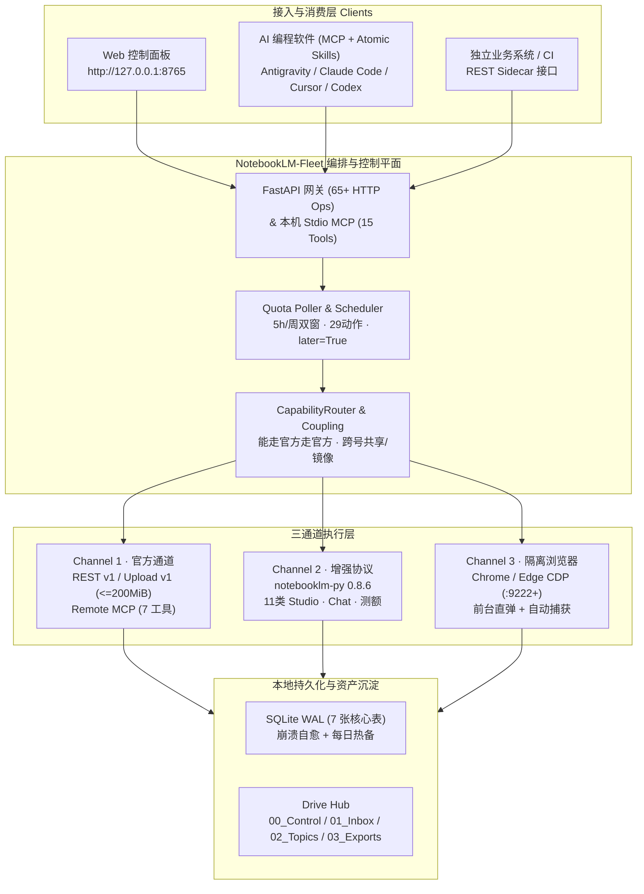

# NotebookLM-Fleet

[](pyproject.toml)
[](app/main.py)
[](app/mcp_server.py)
[](https://github.com/wangsiyi7/NotebookLM-Fleet/releases/tag/v0.4.0)
[](LICENSE)
[](https://github.com/wangsiyi7/NotebookLM-Fleet/actions/workflows/ci.yml)

> **Windows x64 开箱即用桌面端 + 本地优先的多账号 NotebookLM / Gemini Notebook 智能编排中枢、百度网盘 ⇄ Google 云盘双向互通桥接器、官方 API v1 + Remote MCP 统一网关。**

`NotebookLM-Fleet` 将 **Google 官方 REST API v1 / Remote MCP (Nov 2026 Personal Beta)**、**Web 增强协议 (`notebooklm-py`)** 与 **独立隔离 Chrome / Edge CDP 浏览器通道** 融为一体，解决手点网页时的算力盲区、多号串号、Windows Cookie 数据库锁定以及“AI 编程软件无法联动知识库”等全链路工程痛点。

---

## 核心特性

- **三通道智能路由 (`CapabilityRouter`)**
  - **Channel 1（Google 官方通道）**：直连 `notebook.googleapis.com/v1`、`/upload/v1`（最高支持 `200 MiB` 媒体文件上传）与 `notebook.googleapis.com/mcp`（7 工具 Streamable HTTP），含 OAuth Token 自动重试刷新与 302 浏览器直跳授权。
  - **Channel 2（全能增强协议）**：封装 `notebooklm-py >=0.8.6`，实时探测 **5 小时 / 周双窗口剩余百分比与 29 项动作消耗**，支持全部 **11 类 Studio 多模态产出**（音频播客、视频、电影级视频、PPT 幻灯片、信息图、思维导图、测验、闪卡、简报、学习指南、对比表 CSV）与可溯源 Chat 问答。
  - **Channel 3（隔离 Chrome / Edge · CMD 脚本直连 · 长期持久续期 `v0.3.1`）**：
    - 支持一键弹出独立 Chrome 或 Edge（`:9222+` 独立用户目录）并自动跳转到最新 Google `AccountChooser` 登录页，免关日常浏览器每 2.5 秒自动完成 CDP 捕获；
    - 遇到隔离桌面或受限启动环境时**自动侦测并提示，绝不静默假装已弹窗**，提供 **一键激活 CMD 登录终端 / 下载双击 `.cmd` 脚本** 完成真实桌面登录；
    - 完整保留 `accounts.google.com` `LSID` + 应用 `OSID` 持久标识，支持 **后台测额自动无感续期 + 卡片「♻️ 无感续期」**，避免短效 cURL 频繁掉线，并兼容 5 秒粘贴 `Copy as cURL`。
- **额度感知分级调度 (`Tier-Aware Scheduler`)**
  - 支持 `conserve_ultra` / `ultra_first` / `balanced` 三种调度策略与安全水位保护；
  - 重负载高消耗任务自动优先匹配 Ultra；配额触顶自动降级进入 **`later=True` 官方延时队列** 或 **`waiting_quota` 重置唤醒状态机**；服务崩溃重启自动恢复 `'running'` 僵尸任务。
- **跨账号耦合与标准化 Drive Hub**
  - 通过 Editor 共享 + Google Drive Hub 镜像双兜底让多号协同生产同一主题，所有产物按 `00_Control` / `01_Inbox` / `02_Topics/<主题>/{Sources,Artifacts}` / `03_Exports` 自动归档。
  - **Studio 内容占比与笔记本全景 (`v0.2.0`)**：同步全库笔记本及真实来源数，自动扫描并统计每个笔记本与全库池的视频 / 音频 / 幻灯片 / 思维导图 / 测验 / 闪卡 / 交互微应用等多模态 **Studio 占比分布**；点击任意笔记本卡片可打开独立子网页 (`/notebooks/{id}`)，内含 SVG 环形分布图、按类筛选下载至 Drive Hub、来源快速追加与可溯源对话。
- **双向云盘互通（`v0.3.0` · 百度网盘 ⇄ Google 云盘）**
  - **统一免安装浏览器扫码 / cURL 认证**：独立隔离 Chrome/Edge 扫码窗 + CDP 捕获或粘贴 `Copy as cURL` 导入 `BDUSS`/`STOKEN`，免关日常浏览器；
  - **百度网盘 ➔ Google 云盘**：递归目录保留、`.bdpart` 断点续传、按文件大小增量跳过，且支持**同步后一键自动入库到指定 NotebookLM 主题**；
  - **Google 云盘 ➔ 百度网盘**：支持反向勾选 Google 云盘 / `NLM_Hub` / 子页面本地导出成品一键上传备份至百度网盘，底层严格校验允许根路径并屏蔽密钥文件；
  - **自动探测 Google 云盘盘符**：动态扫描 Windows 逻辑盘符与 DriveFS 注册表挂载点（`我的云端硬盘` / `My Drive`），不再硬编码盘符。
- **Studio 多模态生产引擎 & 本地富媒体内容阅读器 (`v0.4.0`)**
  - **Studio 协议兼容与电影级视频直出**：全链路采用 Google Wire 语言码 `zh_Hans`（兼容自动清洗 `zh-Hans` 等输入），针对官方 **电影级视频 (`cinematic_video`)** 固定锁定 `en` 提交并提供独立英文/双语提示词框与「一键直接生成」入口；引入三阶段释放锁调度与后台任务安全回收，支持长达 30–40 分钟的 Veo 3 渲染无阻塞执行。
  - **内置本地多模态内容阅读器**：支持直接在网页/桌面窗内预览工作区与云盘导出的 **Markdown 排版渲染 / 原始文本切换**、原生内嵌 **PDF 阅读**、图片、音频播放与 `.mp4` 视频播放。
  - **去堆积空间重设计布局**：主控台升级紧凑单行顶栏 + 6 格统合指标条 + 无滚动条分段胶囊导航；笔记本详情页（`/notebooks/{id}`）采用左侧内容主栏 + 右侧粘性 **Studio 快速生成工作台与环形占比图** 双栏布局。
- **Windows x64 原生桌面应用 + 本地服务器双模式 (`v0.4.0`)**
  - 内置 **Edge WebView2 原生窗口 + Windows 系统托盘保活 + 单实例唤醒**，点击笔记本卡片可弹出独立原生子窗口 (`/notebooks/{id}`)；
  - 集成系统原生文件夹选择器与资源管理器文件定位，提供 Inno Setup 标准安装向导 (`Setup-win64.exe`，开始菜单同时提供桌面端与本地 Web 服务器快捷入口) 与绿色便携压缩包 (`portable-win64.zip`，内置 `启动桌面应用.cmd` 与 `启动本地Web服务器.cmd`)。
- **开箱即用 Web 控制面板 + 跨 IDE 原子技能包**
  - 内置常驻全工作区文件浏览器、预览与资料篮（`http://127.0.0.1:8765`）；
  - 对上同时提供 **REST API**、**15 工具本机 Stdio MCP**（含 `fleet_bridge_*` 跨云工具）与 **6 个跨工具原子化 Skills**（适配 **Antigravity / Claude Code / Cursor / Codex / Windsurf**）。

---

## 系统架构



---

## 网页 vs 官方 API vs NotebookLM-Fleet 能力对比

| 能力维度 | NotebookLM 网页端 | Google 官方 API + MCP (Ch1) | 完整 `NotebookLM-Fleet` (Ch1+Ch2+Ch3) |
|---|---|---|---|
| 建本 / 列表 / 重命名 | 手工点选 | **原生支持** (REST + MCP) | **支持**（智能路由 + 跨号同步） |
| 批量导入 URL / MD / PDF (`<=200MiB`) | 逐一上传 | **原生支持**（REST / Upload v1） | **支持**（侧栏勾选一键批量入库并校验 `ACTIVE`） |
| 5 小时 / 周实时余量与 29 项消耗 | 不可见 | 官方暂未开放 | **实时探测** + 重置倒计时 |
| 11 类 Studio 自动生产与下载 | 逐个手动触发 | 官方暂未开放 | **批量队列 + `later=True` + 网盘自动归档** |
| 基于来源的可溯源 Chat 问答 | 网页手动问答 | 官方暂未开放 | **异步提问 + Note 存档 + 本地 `.md` 导出** |
| 免关日常 Chrome 无锁多账号认证 | 手动切 Profile | 标准 OAuth 2.0 | **1-Click Chrome/Edge 自动捕获 + cURL 导入** |

---

## Windows x64 桌面安装包 & 本地服务器双模运行 (`v0.4.0`)

团队成员无需配置 Python 环境，直接从 [GitHub Releases v0.4.0](https://github.com/wangsiyi7/NotebookLM-Fleet/releases/tag/v0.4.0) 下载即可按需运行：

1. **完整桌面安装程序（推荐 · Setup EXE）**：下载 `NotebookLM-Fleet-v0.4.0-Setup-win64.exe`，双击安装（含桌面快捷方式、系统托盘与完整卸载，开始菜单同时提供 `NotebookLM-Fleet` 桌面窗与 `NotebookLM-Fleet (Local Web Server)` 本地服务器入口；数据持久化至 `%LOCALAPPDATA%\NotebookLM-Fleet\data`）。
2. **绿色免安装便携压缩包（Portable ZIP）**：下载 `NotebookLM-Fleet-v0.4.0-portable-win64.zip`，解压后双击：
   - `启动桌面应用.cmd`（或 `NotebookLM-Fleet.exe`）：启动完整桌面端应用；
   - `启动本地Web服务器.cmd`：以纯 Web/API 服务器模式启动在 `http://127.0.0.1:8765`；
   - 内置 `portable.flag`，所有配置与数据库自动保存在程序同级 `data/` 目录。
3. **服务器 / 局域网与命令行模式（基于 `NotebookLM-Fleet.exe`）**：
   - `NotebookLM-Fleet.exe --server-only --port 8765`：纯本机后台 Web/API 服务器模式并打开浏览器；
   - `NotebookLM-Fleet.exe --server-only --host 0.0.0.0 --port 8765 --no-browser`：绑定所有网卡，适合部署在局域网或 Windows 服务器后台常驻；
   - `NotebookLM-Fleet.exe --mcp`：直接以原生 Stdio MCP Server 接入 Claude Desktop / Cursor / Antigravity；
   - 校验文件完整性可使用同页发布的 `SHA256SUMS.txt`。

---

## 3 分钟快速上手（源码开发模式）

### 环境要求
- **Python 3.11+** 与 [`uv`](https://docs.astral.sh/uv/)
- Google Chrome 或 Microsoft Edge（用于一键 OAuth / Ch2 隔离会话同步）

### 1. 拉取仓库并初始化环境

```bash
git clone https://github.com/wangsiyi7/NotebookLM-Fleet.git
cd NotebookLM-Fleet
uv sync
```

### 2. 复制并配置本机环境变量（不会被 Git 追踪）

```powershell
# Windows PowerShell
Copy-Item .env.example .env
# 按需修改 WORKSPACE_ROOT（工作根目录）与 DRIVE_HUB_ROOT（云盘归档目录）
```

```bash
# macOS / Linux
cp .env.example .env
```

### 3. 一键启动服务与控制台

- **Windows PowerShell**：
  ```powershell
  .\scripts\start_fleet.ps1
  ```
- **macOS / Linux**：
  ```bash
  chmod +x ./scripts/start_fleet.sh
  ./scripts/start_fleet.sh
  ```

启动后自动打开 **`http://127.0.0.1:8765`**（接口文档：`http://127.0.0.1:8765/docs`）。

### 4. 配置双通道认证（任选或同时启用）

- **Channel 1（官方 API & Remote MCP）**：按 [官方 API 接入指南](docs/OFFICIAL_API_SETUP.md) 准备 Desktop `client_secret.json` 后，在控制面板「官方 API & MCP 实验室」直接上传并填入 Project ID，点击「官方 API 授权」完成浏览器 302 OAuth。
- **Channel 2（实时测额 / 11 类 Studio / Chat）**：在账号行点击「**一键登录会话**」：
  - **方式一（推荐）**：直接点击「**🚀 用 Chrome 打开登录页**」或「**🌐 用 Edge 打开登录页**」，系统会在桌面**前台**弹出干净的隔离窗口；登录进 `https://notebook.google.com/` 主页后，弹窗每 2.5 秒**自动完成同步并关闭**，无需回点。
  - **方式二（5 秒极速）**：从已登录 `notebook.google.com` 的浏览器 DevTools 复制 `Copy as cURL (bash)` 粘贴提交即可。

---

## 跨 AI 编程工具原子技能包 (`atomic_skills/`) 与 MCP 接入

我们已将 NotebookLM 全套能力拆解为 **6 个高内聚、零耦合的原子 Skill**，适配 **Antigravity、Claude Code、Cursor、Codex、Windsurf**：

| 原子 Skill | 核心职责 | 文档链接 |
|---|---|---|
| `nlm-quota-guard` | 纯只读巡检多账号 5h/周余量、29 项耗能预估 | [`atomic_skills/nlm-quota-guard`](atomic_skills/nlm-quota-guard/SKILL.md) |
| `nlm-official-ingest` | 官方 REST v1 / Remote MCP 建本与高速灌料（校验 `ACTIVE`） | [`atomic_skills/nlm-official-ingest`](atomic_skills/nlm-official-ingest/SKILL.md) |
| `nlm-grounded-qa` | 基于真实来源的可溯源 Chat 问答与 `.md` 存档 | [`atomic_skills/nlm-grounded-qa`](atomic_skills/nlm-grounded-qa/SKILL.md) |
| `nlm-studio-factory` | 11 类多模态产物调度生成与延时收割说明 | [`atomic_skills/nlm-studio-factory`](atomic_skills/nlm-studio-factory/SKILL.md) |
| `nlm-repo-to-notebook` | 代码仓库正交切片、强脱敏过滤与自动化入库 | [`atomic_skills/nlm-repo-to-notebook`](atomic_skills/nlm-repo-to-notebook/SKILL.md) |
| `nlm-account-ops` | 无锁多账号 OAuth / Chrome / Edge / cURL 自愈排障 | [`atomic_skills/nlm-account-ops`](atomic_skills/nlm-account-ops/SKILL.md) |

> 详情与 1 分钟各 IDE 配置方法请见：[`atomic_skills/README.md`](atomic_skills/README.md)

### 本机 Stdio MCP 配置示例（`.mcp.json`）

```json
{
  "mcpServers": {
    "notebooklm-fleet": {
      "command": "uv",
      "args": ["--directory", "/path/to/NotebookLM-Fleet", "run", "python", "-m", "app.mcp_server"]
    }
  }
}
```

---

## 目录结构

```text
NotebookLM-Fleet/
├── desktop_launcher.py               # Windows x64 桌面端入口（PyWebView2 + 系统托盘 + 单实例互斥 + --mcp）
├── app/
│   ├── main.py                       # FastAPI 入口、生命周期恢复、后台轮询与调度双协程
│   ├── config.py                     # 源码与 PyInstaller 冻结态路径统一解析
│   ├── db.py & schema.sql            # SQLite WAL 异步持久层（9 张核心表 + 幂等迁移）
│   ├── mcp_server.py                 # 对本地 AI Agent 暴露的 15 工具 Stdio MCP Server（含跨云互通）
│   ├── adapters/                     # 多通道适配层（official_api / official_mcp_client / nlm_py_adapter / browser_takeover / baidupan_adapter / router）
│   ├── api/                          # 模块化路由（accounts / inventory / tasks / drive / workspace / official / cloud_bridge / system）
│   └── core/                         # 核心引擎（win_runtime / quota_poller / scheduler / coupling / drive_hub / cloud_bridge）
├── web/
│   ├── index.html                    # 主控台（额度总览 / 笔记本全景 Studio / 百度⇄Google 网盘互通 / 官方实验室）
│   └── notebook.html                 # 独立笔记本详情子页面（SVG 环形分布图 / 产物下载与回传百度盘 / 来源 / Chat）
├── build/                            # PyInstaller (.spec) / Inno Setup (.iss) / 自生成应用图标资产
├── atomic_skills/                    # 6 大跨 AI 编程工具原子化 Skill 套件
├── docs/
│   ├── OFFICIAL_API_SETUP.md         # 2026-11 Google 官方 API 开通指南
│   └── sharing_archive_v1/           # 9 章系统白皮书（UTF-8 Markdown / PDF / DOCX + 重导出脚本）
├── Notebook_MD_Assets_NotebookLM-Fleet_v1/  # 7 份并行正交知识库 Markdown 资产（脱敏可直入 Notebook）
├── scripts/                          # Windows 一键构建打包脚本 (build_windows.ps1) 与服务启动脚本
└── tests/                            # 覆盖核心引擎、Studio 统计、Windows 运行时与跨云桥接的 pytest 套件
```

---

## 文档、白皮书与测试

- **团队全景科普与开放架构白皮书（v1.0）**：
  - [Markdown 源码主稿（UTF-8）](docs/sharing_archive_v1/NotebookLM-Fleet_%E7%B3%BB%E7%BB%9F%E8%83%BD%E5%8A%9B%E5%85%A8%E6%99%AF%E4%B8%8E%E5%BC%80%E6%94%BE%E6%9E%B6%E6%9E%84%E7%99%BD%E7%9A%AE%E4%B9%A6_v1.0.md)
  - **已排版矢量 PDF（15 页）与可编辑 Word / Google Docs (`.docx`)**：请前往 [GitHub Release v0.1.0](https://github.com/wangsiyi7/NotebookLM-Fleet/releases/tag/v0.1.0) 直接下载，或本地运行 `./docs/sharing_archive_v1/build_exports.py` 从 Markdown 一键重编译导出。
- **并行 Notebook 知识资产**：[`Notebook_MD_Assets_NotebookLM-Fleet_v1/`](Notebook_MD_Assets_NotebookLM-Fleet_v1/00_%E8%B5%84%E4%BA%A7%E7%9B%AE%E5%BD%95%E4%B8%8E%E5%AF%BC%E5%85%A5%E6%8C%87%E5%8D%97_NotebookLM-Fleet.md)
- **协作与安全规范**：[`CONTRIBUTING.md`](CONTRIBUTING.md)

### 运行自动化测试

```powershell
# 运行全量测试（包含在线探测或用 -k 仅跑离线测试）
uv run python -m pytest -v
```

---

## 安全与合规声明

- 本仓库已严格通过隐私与密钥零泄露校验，`.gitignore` 默认隔离 `.env`、`data/`、`fleet.db`、`client_secret*.json`、`oauth_tokens/` 与浏览器会话档案。
- Channel 1 遵循 Google 官方 Gemini Notebook Personal Preview API 协议；Channel 2 仅限个人合法账号研发、知识管理与内部生产力场景使用。若需构建面向公众的高并发多租户商业 SaaS，请依据 [白皮书第 4 章](docs/sharing_archive_v1/NotebookLM-Fleet_%E7%B3%BB%E7%BB%9F%E8%83%BD%E5%8A%9B%E5%85%A8%E6%99%AF%E4%B8%8E%E5%BC%80%E6%94%BE%E6%9E%B6%E6%9E%84%E7%99%BD%E7%9A%AE%E4%B9%A6_v1.0.md) 建议迁移至 Google Cloud Enterprise NotebookLM 或 Gemini API 官方企业栈。
